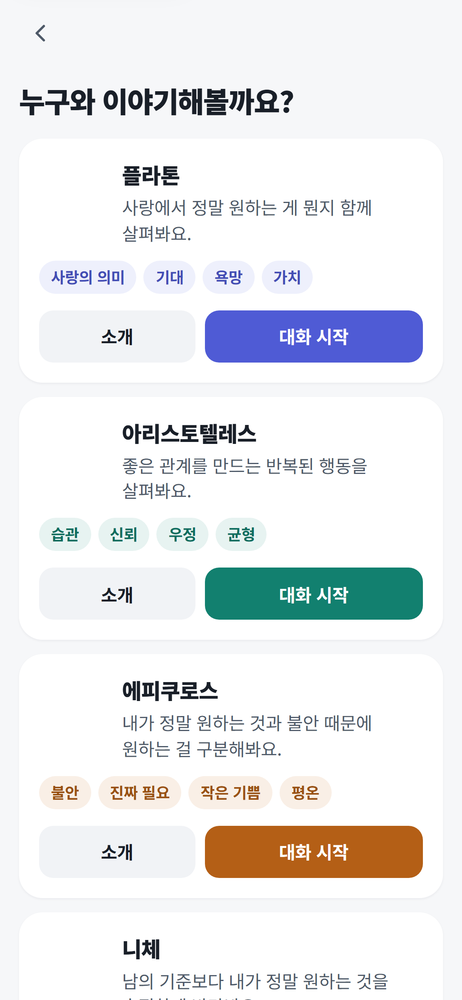
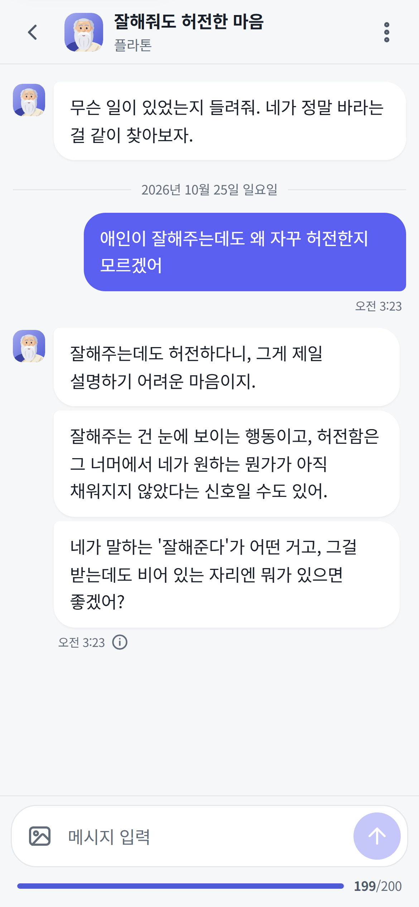
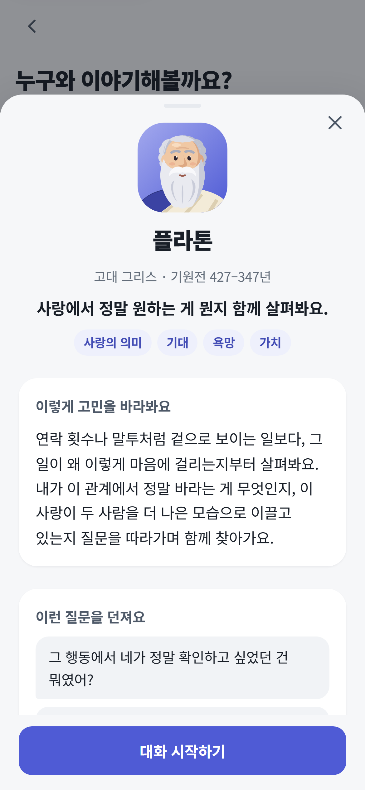
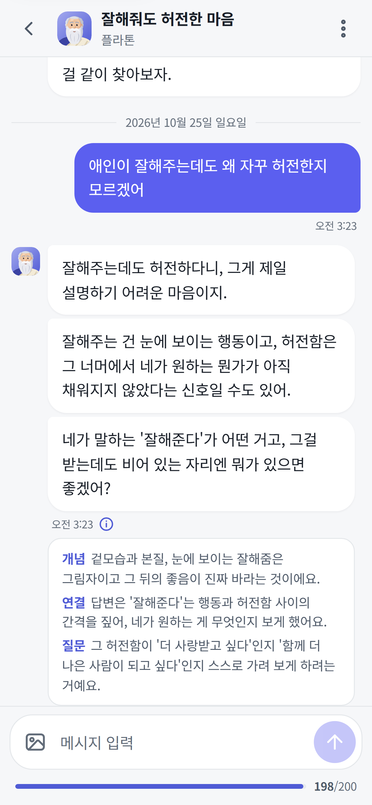

<p align="center">
  <a href="https://askphilo.kro.kr">
    
  </a>
</p>

<h1 align="center">AskPhilo</h1>

<p align="center">
  <strong>철학자와 나누는 연애 상담</strong><br>
  내 마음과 관계를, 조금 다른 시선으로.
</p>

<p align="center">
  <a href="https://askphilo.kro.kr"><strong>서비스 이용하기 →</strong></a>
  &nbsp;·&nbsp; <a href="#서비스-둘러보기">서비스 둘러보기</a>
  &nbsp;·&nbsp; <a href="#함께-이야기할-철학자">철학자 소개</a>
</p>

<p align="center">
  
  
  
  
</p>

## 연애 고민을 함께 살펴보는 대화

연락이 뜸해져 서운할 때, 잘해주는 사람 곁에서도 마음이 허전할 때, 내가 원하는 관계가 무엇인지 헷갈릴 때.
AskPhilo에서는 네 명의 철학자 중 한 명을 골라 친구와 이야기하듯 고민을 나눌 수 있습니다.

철학자의 관점으로 상황을 다시 보고, 내가 중요하게 여기는 것을 찾아갑니다.
**AI가 정답이나 결정을 대신하지 않고, 스스로 판단할 수 있도록 질문을 건넵니다.**

## 서비스 둘러보기

철학자 선택부터 상담과 답변 해설까지, 실제 서비스 화면을 살펴보세요. 대화에는 소개용 예시 질문을 사용했습니다.

<table>
  <tr>
    <th align="center">철학자 선택</th>
    <th align="center">상담 대화</th>
  </tr>
  <tr>
    <td align="center"></td>
    <td align="center"></td>
  </tr>
  <tr>
    <td align="center">나의 고민에 맞는 관점 고르기</td>
    <td align="center">짧은 말풍선으로 이어지는 대화</td>
  </tr>
  <tr>
    <th align="center">철학자 소개</th>
    <th align="center">답변의 철학적 배경</th>
  </tr>
  <tr>
    <td align="center"></td>
    <td align="center"></td>
  </tr>
  <tr>
    <td align="center">대화를 시작하기 전, 철학자의 생각 알아보기</td>
    <td align="center">개념 · 상황과의 연결 · 질문의 의미 확인하기</td>
  </tr>
</table>

## 함께 이야기할 철학자

| 철학자 | 함께 살펴볼 고민 |
| --- | --- |
| <br>**플라톤** | 사랑에서 진정으로 바라는 것과 관계의 가치 |
| <br>**아리스토텔레스** | 좋은 관계를 만드는 습관과 반복되는 행동 |
| <br>**에피쿠로스** | 진짜 원하는 것과 불안에서 비롯된 욕구 |
| <br>**니체** | 타인의 기준을 벗어나 솔직하게 마주하는 나의 마음 |

## 주요 기능

- **글과 사진으로 이야기하기** — 고민과 함께 대화 캡처나 사진을 보낼 수 있습니다.
- **답변의 배경 살펴보기** — 답변에 담긴 철학 개념과 내 고민의 연결을 확인할 수 있습니다.
- **이야기 이어가기** — 저장된 대화를 다시 열어 이어가고, 휴지통에 옮긴 기록은 복원할 수 있습니다.
- **내 속도로 읽기** — 라이트·다크 테마와 말풍선 표시 속도를 선택할 수 있습니다.

<details>
<summary>로컬에서 실행하기</summary>

Python 3.14 기준입니다.

```bash
python -m pip install -r requirements.txt
python wsgi.py
```

`http://localhost:5000`에서 확인할 수 있습니다. 별도 환경 설정이 없으면 모의 AI 응답과 메모리 저장소로 실행되며, 데이터는 재시작 시 초기화됩니다.
실제 AI와 Firestore를 연결하려면 [.env.example](.env.example)을 참고해 `.env`를 설정합니다.

</details>

---

<p align="center">
  UNIST · Technoscience and the Public · Team 6
</p>
